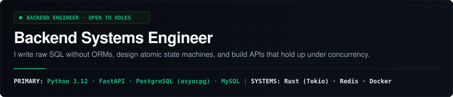
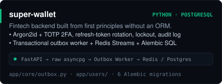
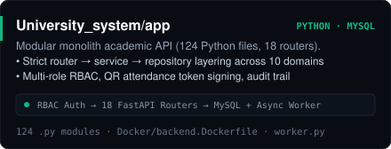
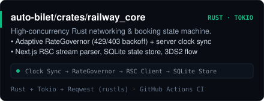
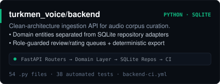

  

### Production & Architectural Codebases

<table width="100%" border="0" cellspacing="0" cellpadding="0">
  <tr>
    <td width="50%" valign="top">
      
    </td>
    <td width="50%" valign="top">
      
    </td>
  </tr>
  <tr>
    <td width="50%" valign="top">
      
    </td>
    <td width="50%" valign="top">
      
    </td>
  </tr>
</table>

---

### How I Engineer Backends

| Problem Area | Approach & Guarantees | Proof in Code |
|---|---|---|
| **Data & SQL** | No ORM magic. Explicit SQL, parameterized queries, schema migrations, integer minor units for money, connection pooling. | [`super-wallet/migrations`](https://github.com/eliotlastdance00-art/super-wallet/tree/main/migrations) · [`asyncpg` database layer](https://github.com/eliotlastdance00-art/super-wallet/blob/main/app/core/database.py) |
| **Auth & Security** | Argon2id hashing, TOTP 2FA, refresh-token rotation, brute-force lockout, RBAC guards, signed QR tokens, immutable audit logs. | [`super-wallet/app/users`](https://github.com/eliotlastdance00-art/super-wallet/tree/main/app/users) · [`University_system/app/auth`](https://github.com/eliotlastdance00-art/University_system/tree/main/app/auth) |
| **Reliability & Async** | Transactional outbox worker, Redis Streams, background workers, adaptive rate-limit governors, deterministic state machines. | [`super-wallet/app/core/outbox.py`](https://github.com/eliotlastdance00-art/super-wallet/blob/main/app/core/outbox.py) · [`railway_core/src/task_engine.rs`](https://github.com/eliotlastdance00-art/auto-bilet/blob/main/crates/railway_core/src/task_engine.rs) |
| **Testing & Delivery** | Clean repository/service boundaries so business logic tests cleanly; Dockerized builds and GitHub Actions CI gates. | [`turkmen_voice/backend` (38 tests)](https://github.com/eliotlastdance00-art/turkmen_voice/tree/main/backend) · [`auto-bilet` Rust CI](https://github.com/eliotlastdance00-art/auto-bilet/tree/main/.github/workflows) |

---

**Looking for:** Backend Engineer roles (`Python` · `FastAPI` · `PostgreSQL` · `Rust`) · [`@eliotlastdance00-art`](https://github.com/eliotlastdance00-art)
