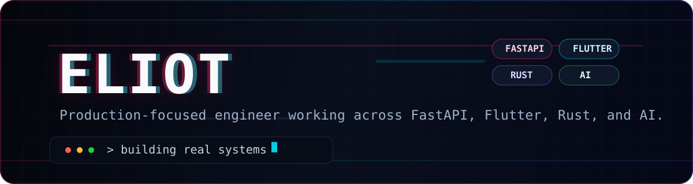

  
   
  
   
  backend systems • mobile apps • applied AI • Turkmen-language technology

<pre>
┌─[eliot@github]─[~/build]
└──╼ $ ship real systems
</pre>

---

## // about

I build production-oriented software at the intersection of **backend engineering**, **mobile development**, and **applied AI**.

My work leans toward systems that need to be **correct, fast, and practical**: financial backends, mobile automation, media forensics, and language technology for low-resource contexts like **Turkmen**.

I care about:
- designing systems from first principles
- building software that survives real usage
- combining strong architecture with product thinking

---

## // flagship systems

### [Find](https://github.com/eliotlastdance00-art/Find)
`MEDIA FORENSICS` `SELF-HOSTED` `EXPLAINABLE AI`

A self-hosted deepfake detection system for video, image, and audio workflows. Built around practical analysis, explainability, and real-world usability instead of notebook-only demos.

- fake probability scoring + Grad-CAM heatmaps
- multilingual product direction: Turkmen, Russian, and English UI
- designed as a usable product, not just isolated inference code

**Stack:** FastAPI · PyTorch · computer vision · audio forensics

---

### [super-wallet](https://github.com/eliotlastdance00-art/super-wallet)
`FINTECH` `LEDGER CORE` `IDEMPOTENCY`

A wallet backend built from first principles around financial correctness: double-entry ledger design, idempotent transaction handling, and integer-precise money flows.

- explicit ledger architecture instead of CRUD-style finance
- transaction correctness as a core system rule
- built for real payment-system constraints and failure cases

**Stack:** FastAPI · PostgreSQL · asyncpg · Redis · Docker

---

### [auto-bilet](https://github.com/eliotlastdance00-art/auto-bilet)
`AUTOMATION` `RUST CORE` `ANDROID`

An advanced Android automation system for ticket monitoring, reservation flow handling, seat selection logic, dual-bank payment support, and automatic OTP capture.

- Rust core integrated into mobile through UniFFI
- reverse-engineered workflow handling for resilience
- exact-timing automation for midnight ticket releases

**Stack:** Rust · Kotlin · Jetpack Compose · Android · UniFFI

---

### [turkmen_voice](https://github.com/eliotlastdance00-art/turkmen_voice)
`SPEECH DATA` `OFFLINE-FIRST` `LOW-RESOURCE NLP`

An offline-first platform for collecting validated Turkmen speech and text data for Whisper and related speech models, with contributor flow, admin review, and export tooling.

- solves a real low-resource language infrastructure problem
- dataset quality control + export workflows
- useful for speech recognition research and fine-tuning

**Stack:** Flutter · FastAPI · SQLite · Whisper tooling

---

## // secondary systems

### [University_system](https://github.com/eliotlastdance00-art/University_system)
Full-stack university management platform with roles, academic structure, attendance, grading, notifications, and audit logging.

**Stack:** FastAPI · MySQL · React · Vite

### [cyber_tools / VoiceReader](https://github.com/eliotlastdance00-art/cyber_tools)
Private on-device PDF and text-to-speech reader for Android, built around offline usage and zero cloud dependency.

**Stack:** Flutter · Dart · Android TTS

---

## // build zones

### backend systems
I enjoy designing APIs and internal services where **correctness, data modeling, and system behavior** matter more than surface-level CRUD speed.

### mobile engineering
I build mobile apps with a strong focus on **practical UX, offline capability, and device-level integration**.

### applied AI
I’m interested in AI systems that solve concrete product problems: **forensics, speech, detection, and language tooling**.

---

## // current signal

- building practical AI products, not just experiments
- improving system design depth in fintech and backend architecture
- expanding Turkmen-language tooling and datasets
- pushing more Rust into performance-sensitive workflows

---

## // stats

  
  

---

## // contact

- GitHub: [@eliotlastdance00-art](https://github.com/eliotlastdance00-art)

**Open to meaningful engineering work, ambitious products, and difficult technical problems.**

